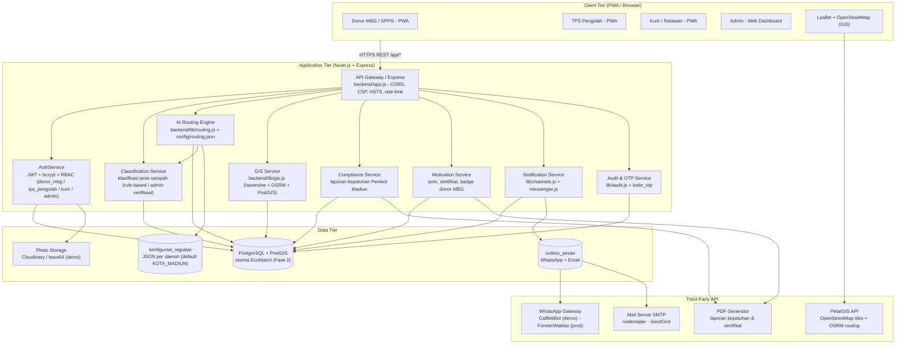
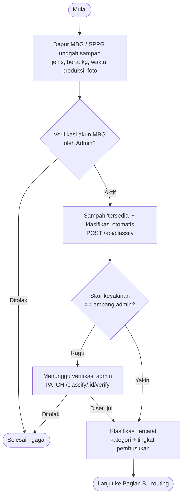
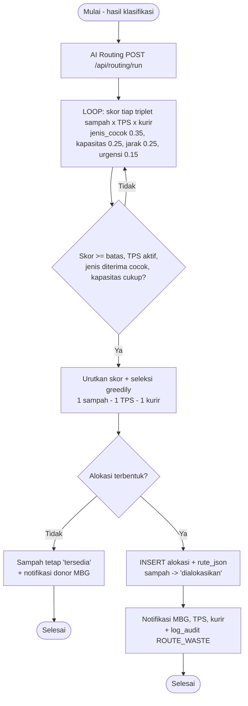
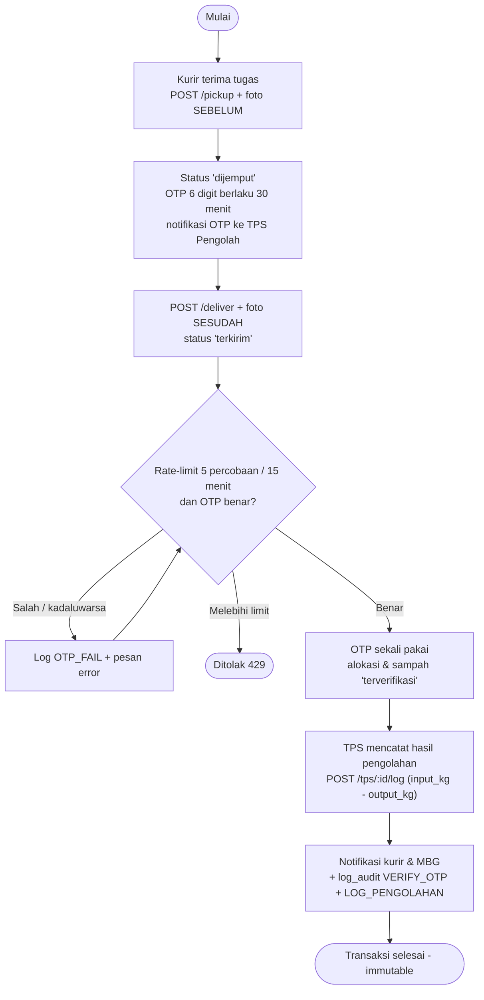
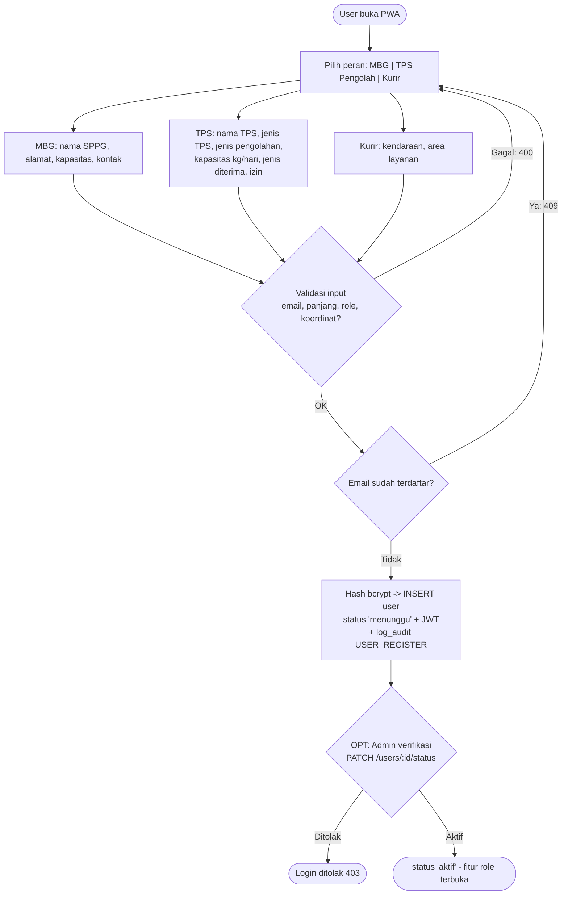
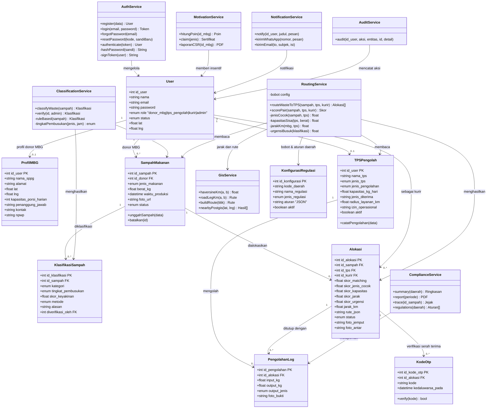
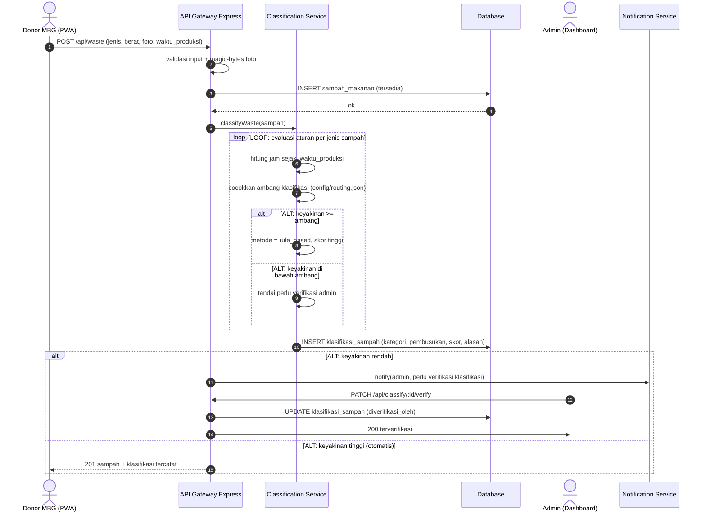
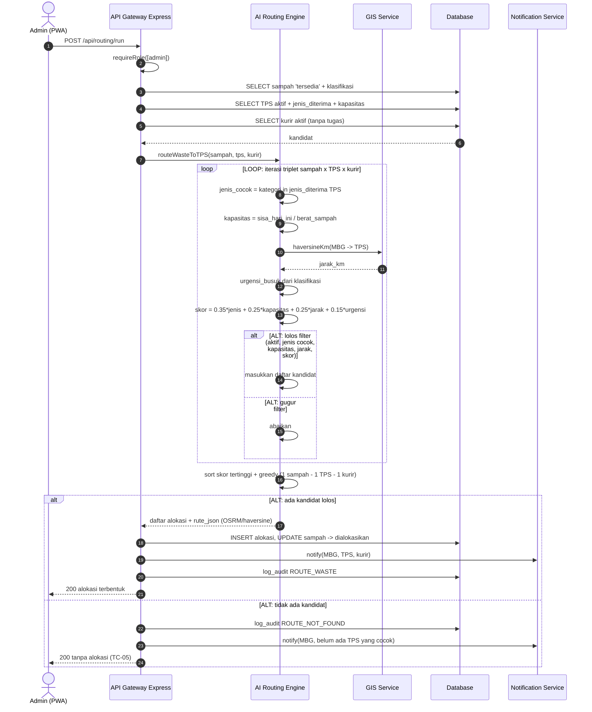
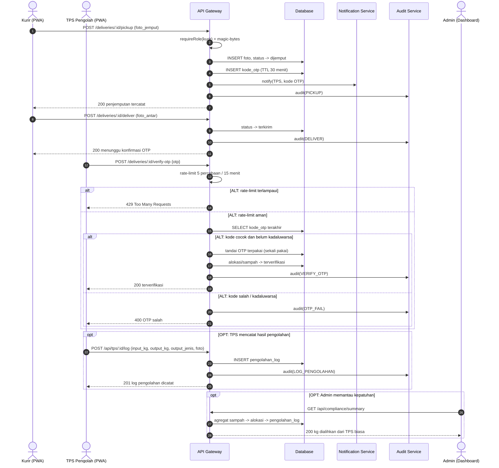
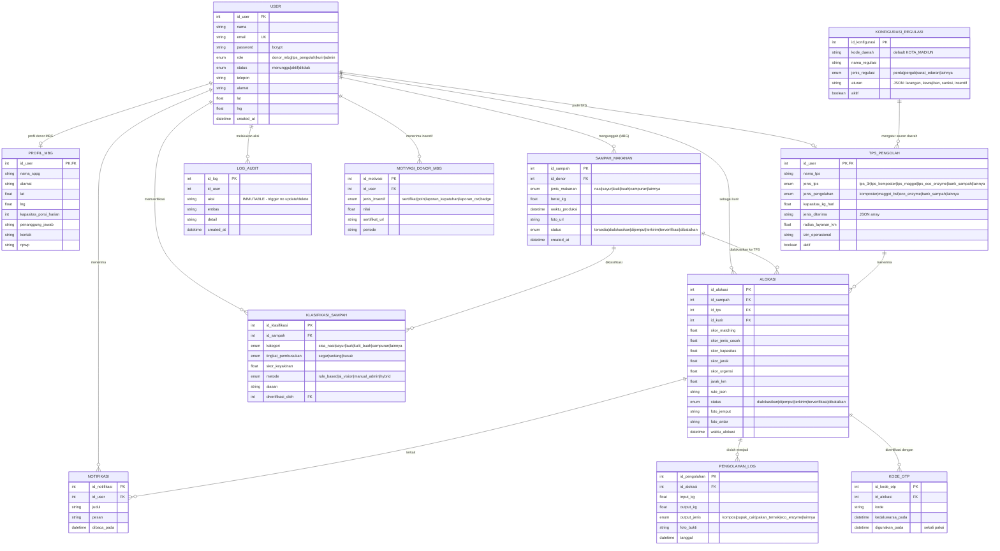

# DOKUMEN ARSITEKTUR SISTEM — EcoMatch
### Platform AI Routing Sampah Makanan MBG ke TPS Pengolah (Studi Kasus: Kota Madiun)
**Tagline:** *"AI pilih TPS, sampah terolah."* · **Versi:** 2.0 (refactor dari Dokumen Arsitektur Sistem versi lama v1.1)
**Dasar:** SKPL EcoMatch (17 FR + 11 NFR) · **Kode:** `C:\Users\nuy07\ecomatch`

---

## 0. Latar Belakang, Aktor & Gambaran Sistem

### 0.1 Latar Belakang
Program **MBG (Makan Bergizi Gratis)** di Kota Madiun menghasilkan **sampah makanan** setiap hari dari dapur/SPPG (nasi sisa, sayur, lauk, kulit buah, campuran). Berdasarkan regulasi daerah, **TPS (Tempat Pembuangan Sementara) biasa sudah tidak boleh / tidak bisa menerima sampah organik**, sehingga sampah makanan MBG **tidak dapat dibuang ke TPS biasa** dan harus dikirim ke **TPS Pengolah yang masih bisa & mau mengolah**: TPS 3R, TPS komposter, TPS dengan unit Maggot BSF, TPS dengan unit Eco-enzyme, bank sampah organik, atau unit pengolahan sampah makanan lain di bawah dinas terkait.

**Masalah:** pengelola MBG tidak tahu TPS mana yang mampu menampung sampah makanannya, jarak & kapasitasnya bagaimana, dan bagaimana membuktikan kepatuhan regulasi ke Pemkot Madiun.
**Solusi EcoMatch:** AI mengklasifikasi jenis sampah lalu **merutekan** sampah MBG ke **TPS Pengolah terbaik** (jenis olahan cocok, kapasitas tersisa, jarak terdekat, urgensi pembusukan), dilengkapi pelacakan (traceability) dan laporan kepatuhan.
**Alur inti:** MBG unggah sampah → AI klasifikasi → AI routing → TPS Pengolah terpilih → kurir jemput & antar → TPS olah → laporan kepatuhan ke Pemkot Madiun.

### 0.2 Aktor Sistem
| # | Aktor | Peran dalam EcoMatch |
|---|-------|----------------------|
| 1 | **Donor — Pengelola MBG / SPPG** | Dapur Makan Bergizi Gratis yang menghasilkan & mengunggah sampah makanan; wajib menyalurkan agar patuh regulasi, menghindari sanksi/denda, bukti kepatuhan laporan ke Pemkot, citra baik CSR, sertifikat & poin |
| 2 | **Penerima — TPS Pengolah** | TPS/unit pengolah di Kota Madiun yang masih bisa menerima & mengolah sampah makanan: TPS 3R, TPS komposter, TPS maggot BSF, TPS eco-enzyme, bank sampah organik, unit pengolahan sampah makanan |
| 3 | **Kurir / Relawan** | Penjemput di dapur MBG & pengantar sampah ke TPS Pengolah (foto bukti + OTP) |
| 4 | **Administrator** | Verifikasi akun & klasifikasi, menjalankan AI routing, konfigurasi regulasi, kelola platform |
| 5 | **Sistem** | Job terjadwal: auto-expire sampah, notifikasi, agregasi laporan kepatuhan |

### 0.3 Motivasi Donor MBG
1. **Kewajiban regulasi** — tidak boleh membuang sampah organik sembarangan.
2. **Menghindari sanksi/denda** dari Pemkot Madiun.
3. **Bukti kepatuhan** untuk laporan ke Pemkot Madiun.
4. **CSR / citra baik** lembaga penyelenggara MBG.
5. **Sertifikat & poin** kepatuhan dari sistem.

---

## 1. Arsitektur 3-Tier (implementasi EcoMatch)



---

## 2. Kebutuhan Fungsional (FR-01 … FR-17) → Rancangan Backend

| Kode | Fitur (SKPL EcoMatch) | Endpoint | Tabel DB | Logic utama | Tech pendukung |
|------|------------------------|----------|----------|-------------|----------------|
| **FR-01** | Autentikasi & RBAC (MBG, TPS Pengolah, Kurir, Admin) | `POST /api/auth/register` · `POST /api/auth/login` · `POST /api/auth/forgot` · `POST /api/auth/reset` | `user`, `reset_sandi` | Register pilih role `donor_mbg\|tps_pengolah\|kurir` → `status='menunggu'`; admin verifikasi | **bcryptjs**, **JWT HS256**, **RBAC** `requireRole([...])`, rate-limit |
| **FR-02** | Unggah sampah makanan (MBG input jenis, berat, foto) | `POST /api/waste` · `GET /api/waste/mine` · `GET /api/waste/:id` · `PATCH /api/waste/:id` · `DELETE /api/waste/:id` | `sampah_makanan` | Simpan jenis_makanan, berat_kg, waktu_produksi, foto; status `tersedia` | **multer** 1 MB + magic-bytes, **Cloudinary/base64** |
| **FR-03** | Profil TPS Pengolah (jenis olahan, kapasitas, jenis diterima) | `GET /api/tps/me` · `PATCH /api/tps/me` | `tps_pengolah` | jenis_tps, jenis_pengolahan, kapasitas_kg_hari, jenis_diterima (JSON array) | validasi `lib/validate.js`, RBAC `tps_pengolah` |
| **FR-04** | AI Routing — cari TPS Pengolah terbaik untuk sampah MBG | `POST /api/routing/run` (admin) · `GET /api/routing` · `GET /api/routing/:id/explain` | `alokasi` (4 sub-skor + `jarak_km` + `rute_json`) | Filter TPS aktif → skor multi-kriteria (jenis_cocok, kapasitas, jarak, urgensi) → greedy | **Routing Engine** `lib/routing.js` + `config/routing.json`; mesin Python (`ai`) |
| **FR-05** | Rute GIS (MBG → TPS Pengolah) | `GET /api/geo` · `GET /api/geo/nearby` · rute di `alokasi.rute_json` | `alokasi.rute_json`, view `v_lokasi_geospasial` | `haversineKm()` + **OSRM** (rute jalan) + `buildRoute()` kurir→MBG→TPS | **Leaflet + OpenStreetMap**, **OSRM**, **PostGIS** `ST_DWithin`/`ST_Distance` |
| **FR-06** | Notifikasi (in-app, WhatsApp, email) | `GET /api/notifications` · `PATCH /api/notifications/:id/read` | `notifikasi`, `outbox_pesan` | In-app + outbox WA/email (antre→terkirim/simulasi/gagal) | **CallMeBot** (demo) → **Fonnte** (prod), **nodemailer** |
| **FR-07** | Foto bukti (pickup & antar) | `POST /api/deliveries/:id/pickup` · `POST /api/deliveries/:id/deliver` | `alokasi.foto_jemput`, `alokasi.foto_antar` | Wajib foto, magic-bytes, status `dijemput`→`terkirim` | multer + validasi buffer + audit |
| **FR-08** | Verifikasi OTP serah terima | `POST /api/deliveries/:id/verify-otp` · `POST /api/deliveries/:id/resend-otp` | `kode_otp` | OTP 6 digit, TTL 30 mnt, **sekali pakai**, 5 percobaan/15 mnt | **crypto.randomInt** + **timingSafeEqual**, rate-limit |
| **FR-09** | Dashboard analitik (kg dialihkan dari TPS biasa, jumlah TPS aktif, coverage) | `GET /api/admin/stats` | agregat `sampah_makanan`, `alokasi`, `tps_pengolah` | kg dialihkan, TPS aktif, cakupan wilayah, grafik | agregasi SQL + index, uptime monitor |
| **FR-10** | Manajemen pengguna & audit | `GET /api/admin/users` · `PATCH /api/admin/users/:id/status` · `GET /api/admin/audit` | `user`, `log_audit` | Verifikasi/nonaktif akun; semua aksi ditulis log | RBAC admin, **log immutable** (trigger DB) |
| **FR-11** | Klasifikasi jenis sampah (AI + verifikasi admin) | `POST /api/classify` · `GET /api/classify/:id` · `PATCH /api/classify/:id/verify` | `klasifikasi_sampah` | `classifyWaste()`: kategori + tingkat_pembusukan + skor keyakinan + alasan; admin verifikasi bila ragu | **rule-based** (default), opsional **TensorFlow.js vision** (saran, wajib admin verifikasi) |
| **FR-12** | Registrasi & profil TPS Pengolah (multi-jenis olahan) | `POST /api/tps/register` · `GET /api/tps/list` · `POST /api/tps/:id/log` · `GET /api/tps/:id/dashboard` | `tps_pengolah`, `pengolahan_log` | Daftar TPS + catat hasil olah (input_kg → output_kg, jenis output) | validasi, RBAC `tps_pengolah` |
| **FR-13** | AI Routing sampah organik ke TPS Pengolah | (bagian dari FR-04) | `alokasi` | Bobot: jenis_cocok 0.35 · kapasitas 0.25 · jarak 0.25 · urgensi 0.15 | `config/routing.json`, greedy assignment |
| **FR-14** | Dashboard kepatuhan regulasi Madiun | `GET /api/compliance/summary` · `GET /api/compliance/report` · `GET /api/compliance/trace/:id` · `GET /api/compliance/regulations` | join `sampah_makanan → klasifikasi → alokasi → pengolahan_log` | kg dialihkan, % sampah tidak ke TPS biasa, traceability end-to-end | **PDF generation**, agregasi SQL |
| **FR-15** | Modul motivasi MBG (sertifikat, poin, laporan kepatuhan) | `GET /api/mbg/motivation` · `POST /api/mbg/motivation/claim` · `GET /api/admin/mbg/report` | `motivasi_donor_mbg` | Akumulasi poin per kg dialihkan; klaim sertifikat/laporan CSR | **PDF generation** |
| **FR-16** | Konfigurasi regulasi daerah | `POST /api/admin/regulations` · `PATCH /api/admin/regulations/:id` · `GET /api/admin/regulations` | `konfigurasi_regulasi` | Aturan larangan/kewajiban/sanksi/insentif dalam JSON per daerah | **JSON per daerah**, default `KOTA_MADIUN` |
| **FR-17** | Traceability sampah end-to-end | `GET /api/compliance/trace/:id` | `sampah_makanan → klasifikasi_sampah → alokasi → pengolahan_log` | Riwayat penuh: MBG → TPS → output olahan (kompos/pupuk/pakan/eco-enzyme) | join 4 tabel + immutable log |

**Urutan pipeline middleware:**
```
Request → trust proxy → security headers (CSP/HSTS/nosniff) → CORS allowlist
        → express.json(3mb) → boot(seed + auto-expire)
        → router /api/* → authenticate(JWT) → requireActive → requireRole([role])
        → validasi input → handler → audit() + notify() → response JSON
```

---

## 3. Kebutuhan Non-Fungsional (NFR-01 … NFR-11) → Keputusan Arsitektur

| Kode | Kebutuhan | Keputusan Desain Backend | Implementasi di Kode |
|------|-----------|--------------------------|----------------------|
| **NFR-01** | Keamanan: autentikasi, enkripsi password, RBAC | Stateless token + hash satu-arah + guard per-role per-route | `bcryptjs`, `jsonwebtoken` (exp 12 jam), `authenticate/requireRole/requireActive`, parameterized query |
| **NFR-02** | Performa: respons & AI Routing < 3 detik | Routing **in-process** (fallback JS) + layanan Python lokal dengan timeout; query terindeks | `lib/routing.js`, `lib/aiService.js` (timeout 1.8 dtk → fallback), index unik alokasi |
| **NFR-03** | Ketersediaan 24/7, uptime ≥ 99% | Healthcheck, auto-restart, monitoring berkala, deploy managed | `GET /api/health`, GitHub Actions monitor 15 menit, `nixpacks.toml`/`railway.json`, backup DB |
| **NFR-04** | Skalabilitas 5.000 pengguna aktif | **Tanpa state sesi** (JWT) → horizontal scale; PostgreSQL + PostGIS; rate-limit | JWT stateless, `DATABASE_URL` (PostgreSQL), rate-limit per IP+email |
| **NFR-05** | Usability: minim langkah input, ramah kurir dasar | API tunggal per aksi, pesan error JSON konsisten, PWA offline-first | Response `{message/error}` seragam, SW + manifest PWA, form lokasi terpandu |
| **NFR-06** | Akurasi jarak/rute ≥ 95% | Pisahkan **perhitungan jarak** dari **visualisasi peta**; adapter GIS bisa ditukar | `lib/gis.js`: **OSRM** (rute jalan) dengan fallback haversine; jarak lurus tetap untuk skor awal |
| **NFR-07** | Portabilitas: Android/iOS 3 thn terakhir + browser modern | Aplikasi sebagai **PWA** (installable) alih-alih native 2 platform | `manifest.webmanifest`, service worker, target evergreen browser, CSP ketat |
| **NFR-08** | Auditabilitas: log tak bisa diubah | **Immutable di level DB**, bukti foto + OTP sekali pakai | Trigger `log_audit_no_update` & `log_audit_no_delete` (SQLite `RAISE(ABORT)` / PostgreSQL `RAISE EXCEPTION`), foto pickup/antar, OTP sekali pakai |
| **NFR-09** | **Kepatuhan regulasi Madiun (traceability)** | Setiap kg sampah terlacak MBG → TPS → output olahan; laporan siap cetak | Tabel `pengolahan_log`, endpoint `/api/compliance/*`, log audit immutabel |
| **NFR-10** | **Akurasi klasifikasi jenis sampah ≥ 85%** | Rule-based transparan + **skor keyakinan** + verifikasi admin bila `skor < ambang` | `klasifikasi_sampah.skor_keyakinan`, `metode`, `alasan`; jalur verifikasi admin |
| **NFR-11** | **Fleksibilitas konfigurasi daerah** | Aturan regulasi sebagai data (JSON), bukan hardcode | Tabel `konfigurasi_regulasi` (kode_daerah, aturan JSON), default `KOTA_MADIUN` |

---

## 4. Keputusan Desain (K-11 … K-15)

> Nomorasi dimulai dari K-11 mengikuti dokumen arsitektur versi sebelumnya (v1.1) yang memuat K-01 … K-10.

| Kode | Keputusan | Alasan |
|------|-----------|--------|
| **K-11** | **AI Routing sampah ke TPS Pengolah (bukan TPS biasa)** — daftar TPS Pengolah difilter hanya yang `aktif` DAN `jenis_diterima` memuat kategori sampah | Regulasi Kota Madiun: TPS biasa tidak boleh menerima sampah organik; sistem tidak boleh mengarahkan sampah MBG ke TPS non-pengolah |
| **K-12** | **Klasifikasi jenis sampah + verifikasi admin** — hasil mesin (rule-based/AI vision) berstatus saran sampai diverifikasi admin bila keyakinan rendah | NFR-10: jaga akurasi ≥ 85% tanpa memblokir alur (default otomatis untuk keyakinan tinggi) |
| **K-13** | **Modul motivasi donor MBG** (kepatuhan + CSR): poin per kg dialihkan, sertifikat, laporan CSR | Mendorong kepatuhan sukarela & memberi bukti pelaporan ke Pemkot (motivasi donor §0.3) |
| **K-14** | **Konfigurasi regulasi daerah sebagai data** (JSON per `kode_daerah`), default `KOTA_MADIUN` | NFR-11: regulasi bisa berubah/perluasan kota tanpa perubahan kode |
| **K-15** | **Traceability sampah end-to-end**: setiap `alokasi` wajib berpasangan dengan `klasifikasi_sampah` dan ditutup `pengolahan_log` | NFR-09: bukti rantai penanganan dari dapur MBG → TPS → output olahan untuk audit kepatuhan |

---

---

## 5. Diagram

### 5.1 Activity Diagram — Unggah Sampah MBG → Klasifikasi → Routing ke TPS (FR-02, FR-11, FR-13)

**Bagian A - unggah & klasifikasi sampah:**



**Bagian B - AI routing & alokasi:**



### 5.2 Activity Diagram — Serah Terima & OTP di TPS Pengolah (FR-07, FR-08)



### 5.3 Activity Diagram — Registrasi & Verifikasi Akun Multi-Role (FR-01, FR-12)



### 5.4 Class Diagram (Backend EcoMatch)




### 5.5 Sequence Diagram — Klasifikasi Sampah MBG (wajib fragmen LOOP + ALT)



### 5.6 Sequence Diagram — Routing Sampah MBG → TPS Pengolah (wajib fragmen ALT)



### 5.7 Sequence Diagram — Serah Terima OTP & Pengolahan (wajib fragmen ALT + OPT)



---

## 6. ERD (Entity Relationship Diagram — skema EcoMatch)

> Detail kolom & file SQL ada di **Fase 2** (`schema_ecomatch.sql`, `ERD_EcoMatch.png`). Ringkas di sini:



---

## 7. Stack Teknologi (implementasi EcoMatch)

| Layer | Teknologi | Alasan / Kebutuhan yang Dilayani |
|-------|-----------|----------------------------------|
| Runtime backend | **Node.js 24** (`engines: >=20`) | NFR-02, NFR-04 |
| Web framework | **Express 4** + helmet + cors + compression + express-rate-limit | NFR-01, NFR-04 |
| Basis data utama | **PostgreSQL 16 + PostGIS 3.4** (Docker `ecomatch-postgis`, port 5433) | FR-17, NFR-06, NFR-09 |
| Basis data fallback/demo | libSQL/TurSQL (`file:local.db`) — driver lintas-dialek di `backend/db.js` | portabilitas (NFR-07) |
| Basis data driver | `pg` (PG) + `@libsql/client` (SQLite) — transisi mulus | transisi nol waktu henti |
| Otorisasi | **JWT HS256** (12 jam) + **bcryptjs** + RBAC `donor_mbg\|tps_pengolah\|kurir\|admin` | FR-01, NFR-01 |
| Klasifikasi sampah | **Rule-based engine** (`ai`) + verifikasi admin; opsional **TensorFlow.js vision** | FR-11, NFR-10 |
| AI routing | `backend/lib/routing.js` (JS, in-process) + **mesin Python FastAPI** `ai` (`:8001`) dengan timeout & fallback | FR-04/FR-13, NFR-02 |
| GIS & rute | **Leaflet + OpenStreetMap** (client), **OSRM public** (rute jalan), haversine (fallback), **PostGIS** `ST_DWithin`/`ST_Distance` | FR-05, NFR-06 |
| Foto bukti | multer (1 MB, magic-bytes) → Cloudinary (prod) / base64 (demo) | FR-07, NFR-08 |
| Notifikasi | **WhatsApp CallMeBot** (demo) → Fonnte/Wablas (prod) + **nodemailer** SMTP + inbox in-app via `outbox_pesan` | FR-06 |
| Kepatuhan & insentif | **PDF generation** (laporan kepatuhan, sertifikat, laporan CSR) | FR-14, FR-15, NFR-09 |
| Audit | tabel `log_audit` + **trigger immutable** (PG `RAISE EXCEPTION` / SQLite `RAISE(ABORT)`) | NFR-08 |
| Konfigurasi regulasi | JSON per `kode_daerah`, default `KOTA_MADIUN` | FR-16, NFR-11 |
| Client | **PWA** (vanilla JS): `manifest.webmanifest` + service worker + cache offline | NFR-05, NFR-07 |
| Deploy & operasi | nixpacks.toml / railway.json, GitHub Actions health monitor 15 menit, backup DB harian | NFR-03 |

### 7.1 Mengetahui dan keputusan perubahan (basis v1.1 → v2.0)

| # | v1.1 (versi lama) | v2.0 (EcoMatch) | Keputusan |
|---|---------------------|------------------|-----------|
| 1 | Donor → penerima surplus makanan (manusia), TPS `lokasi_makanan` | Donor **MBG** → **TPS Pengolah** yang masih bisa menerima & mengolah; TPS biasa dilarang terima sampah organik | K-11 |
| 2 | Rekomendasi `penyaluran` surplus + impact metrics | **Klasifikasi + AI Routing** sampah ke TPS terbaik (jenis, kapasitas, jarak, urgensi) | FR-11, FR-13 |
| 3 | Skema v1.1 (`surplus_makanan`, `kebutuhan_makanan`) | Skema baru `sampah_makanan`, `klasifikasi_sampah`, `tps_pengolah`, `pengolahan_log`, `motivasi_donor_mbg`, `konfigurasi_regulasi` (Fase 2) | FR-02…17 |
| 4 | 10 FR + 8 NFR | **17 FR + 11 NFR** (NFR-09 kepatuhan, NFR-10 klasifikasi, NFR-11 konfigurasi daerah) | SKPL v2.0 |
| 5 | Motivasi: donor umum (CSR, komunitas) | **Motivasi donor MBG**: kepatuhan regulasi, hindari sanksi, laporan Pemkot, CSR, sertifikat & poin | FR-15, K-13 |
| 6 | Belum ada konfigurasi daerah | **`konfigurasi_regulasi` JSON per daerah**, default `KOTA_MADIUN` | FR-16, NFR-11, K-14 |
| 7 | Traceability tidak eksplisit | **Traceability end-to-end** MBG → TPS → output olahan + laporan | FR-17, NFR-09, K-15 |

---

## 8. Checklist Kesesuaian Dokumen ↔ Kode

| Item | Status |
|------|--------|
| FR-01 … FR-17 tercantum + mapping endpoint | ☑ (§2) |
| NFR-01 … NFR-11 + keputusan desain | ☑ (§3) |
| Keputusan K-11 … K-15 | ☑ (§4) |
| Diagram: 3 activity (routing, OTP, registrasi), 1 class, 3 sequence (klasifikasi, routing, OTP), ERD | ☑ (§5, §6) |
| Sequence punya fragmen **LOOP** (klasifikasi, routing) dan **ALT** (semua) + **OPT** (§5.7) | ☑ |
| Semua nama lama → **EcoMatch** | ☑ (grep nama lama di repo → 0 hasil) |
| Semua link ke folder lama `manpro & frontend` → padanan lokal `ecomatch` | ☑ |
| Stack & teknologi sesuai repo (`package.json`, `docker-compose`, `ai/`) | ☑ (§7) |
| `schema_ecomatch.sql` + `ERD_EcoMatch.png` | ☐ → **Fase 2** |
| Detail routing engine Python + `config/routing.json` | ☐ → **Fase 3** |
| UML vektor (.drawio/.svg) + naskah uji 30 skenario | ☑ (**Fase 6**: `docs/arsitektur/UML_EcoMatch.drawio` 12 halaman + `docs/pengujian/Laporan_Evaluasi_System.md`) |

---

## 9. Lampiran

**A. Gambar diagram** (`<folder>\diagram\`)

| Gambar | File output (render Fase 1a) |
|--------|------------------------------|
| Arsitektur 3-Tier | `EcoMatch_01_arsitektur_3tier.png` |
| Activity unggah & klasifikasi MBG | `EcoMatch_02a_activity_klasifikasi.png` |
| Activity AI routing MBG→TPS | `EcoMatch_02b_activity_routing.png` |
| Activity serah terima OTP | `EcoMatch_03_activity_otp.png` |
| Activity registrasi multi-role | `EcoMatch_04_activity_registrasi.png` |
| Class diagram backend | `EcoMatch_05_class.png` |
| Sequence klasifikasi sampah | `EcoMatch_06_sequence_klasifikasi.png` |
| Sequence routing MBG→TPS | `EcoMatch_07_sequence_routing.png` |
| Sequence OTP + pengolahan | `EcoMatch_08_sequence_otp.png` |
| ERD EcoMatch | `ERD_EcoMatch.png` (**Fase 2**) |

**B. Berkas terkait di repository**
- `Dokumen_Arsitektur_Sistem_EcoMatch_v2.0.md` / `.docx` — dokumen ini
- `SKPL_EcoMatch_v2.0.docx` — spesifikasi kebutuhan perangkat lunak (Fase 1b)
- `schema_ecomatch.sql`, `ERD_EcoMatch.png` — Fase 2
- `config/routing.json`, `ai/` — Fase 3
- `backend/` (routes, lib), `frontend/` (PWA) — Fase 4 & 5
- `docs/arsitektur/UML_EcoMatch.drawio` (12 halaman), `docs/pengujian/Laporan_Evaluasi_System.md`, generator `scripts/gen_uml_drawio.py` — Fase 6

**C. Nama halaman UML Fase 6** (dihasilkan `scripts/gen_uml_drawio.py` dari mermaid §1/§5/§6 + 2 diagram turunan kode backend): `arsitektur-3tier-ecomatch`, `activity-unggah-klasifikasi-mbg`, `activity-routing-mbg-tps`, `activity-serah-terima-otp`, `activity-registrasi-eco-match`, `class-backend-eco-match`, `sequence-klasifikasi-sampah`, `sequence-routing-mbg-tps`, `sequence-serah-terima-otp`, `sequence-compliance`, `activity-pengolahan-tps`, `erd-eco-match`.

---

*Dokumen Arsitektur Sistem EcoMatch v2.0 — disusun ulang dari Dokumen Arsitektur Backend versi lama v1.1 sebagai bagian dari Fase 1 refactor total ke proyek **EcoMatch — AI Routing Sampah Makanan MBG ke TPS Pengolah (Kota Madiun)**.*
